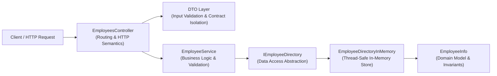

# Employee Directory API

[](https://dotnet.microsoft.com/)
[](https://learn.microsoft.com/aspnet/core)
[](https://learn.microsoft.com/dotnet/csharp/)

A clean, asynchronous RESTful Web API for managing employee records, built with **ASP.NET Core** and **C# / .NET 10**. Designed with clean architecture principles, strict DTO contract isolation, robust data validation, and non-blocking asynchronous operations.

---

## 📌 Features

- **Full Employee Lifecycle (CRUD)**: Create, retrieve, update, delete, and search employee records.
- **Advanced Multi-Criteria Search**: Case-insensitive substring filtering by employee name and department.
- **Clean 3-Tier Layered Architecture**: Strict separation of concerns between Controllers, Services, Repositories, and Domain Models.
- **DTO Contract Isolation**: Domain entities are never exposed to HTTP consumers; sensitive business attributes (e.g., salary details) are encapsulated.
- **Strict Defensive Validation**: Model validation using `DataAnnotations` (`[Required]`, `[Length]`, `[Range]`) paired with nullable value types to prevent missing JSON keys from silently adopting zero-value defaults.
- **Domain Guard Clauses**: Domain entities encapsulate their own invariants (e.g., preventing negative salaries).
- **Asynchronous & Cancellable**: Full `async`/`await` pipeline with `CancellationToken` support propagated across all layers to ensure graceful request cancellation.
- **Predictable REST Status Codes**: Accurate HTTP response mapping (`201 Created`, `200 OK`, `204 No Content`, `400 Bad Request`, `404 Not Found`, `409 Conflict`) with ASP.NET Core `ProblemDetails`.
- **Integrated API Testing & Docs**: OpenAPI support out-of-the-box and a ready-to-run `.http` test specification file for VS Code, Visual Studio, and Rider.

---

## 🏗️ Architecture & Design

The application follows a decoupled, layered architecture:



### Layer Responsibilities

1. **Controller Layer (`Controllers/`)**:
   Handles incoming HTTP requests, enforces routing, validates query/path parameters, and returns standard HTTP responses (`CreatedAtAction`, `Ok`, `NotFound`, `Conflict`, etc.).
2. **Service Layer (`Services/`)**:
   Contains business logic orchestration. Maps incoming commands to domain models and raises strongly-typed domain exceptions when business rules are violated.
3. **Repository Layer (`Repositories/`)**:
   Abstracted behind the `IEmployeeDirectory` interface, isolating data storage mechanics from the rest of the application.
4. **Data Transfer Objects (`Dtos/`)**:
   - `AddEmployeeRequest` & `EditEmployeeRequest`: Validated input payloads.
   - `AddEmployeeCommand`: Immutable internal command record passed to the service layer.
   - `EmployeeResponse`: Public-facing presentation model, omitting private domain data.
5. **Domain Model (`Models/`)**:
   Encapsulated `EmployeeInfo` class with internal property validation guards.

---

## 🛠️ Tech Stack

- **Framework**: ASP.NET Core Web API (.NET 10)
- **Language**: C# 13 (Primary constructors, records, nullable reference types, file-scoped namespaces)
- **Dependency Injection**: ASP.NET Core Native IoC container
- **Documentation**: Microsoft.AspNetCore.OpenApi
- **Testing Tools**: `.http` REST Client file (`EmployeeDirWeb.http`), `curl`

---

## 📡 API Reference

Base URL: `http://localhost:5264` / `https://localhost:7039`

| Method | Endpoint | Description | Response Status |
|---|---|---|---|
| `POST` | `/api/employees` | Add a new employee | `201 Created`, `400 Bad Request`, `409 Conflict` |
| `GET` | `/api/employees/{id}` | Get employee by ID | `200 OK`, `400 Bad Request`, `404 Not Found` |
| `GET` | `/api/employees` | Search employees by name or department | `200 OK` |
| `PUT` | `/api/employees/{id}` | Update an existing employee | `200 OK`, `400 Bad Request`, `404 Not Found` |
| `DELETE` | `/api/employees/{id}` | Remove an employee | `204 No Content`, `400 Bad Request` |

### Endpoint Details & Examples

#### 1. Add Employee
- **Route**: `POST /api/employees`
- **Headers**: `Content-Type: application/json`

**Request Body:**
```json
{
  "id": "EMP-101",
  "name": "Alex Mercer",
  "department": "Engineering",
  "salary": 82000,
  "hiredDate": "2024-02-01"
}
```

**Response (`201 Created`):**
```json
{
  "id": "EMP-101",
  "name": "Alex Mercer",
  "department": "Engineering"
}
```
*Includes `Location` response header: `/api/employees/EMP-101`.*

---

#### 2. Get Employee by ID
- **Route**: `GET /api/employees/{id}`

**Response (`200 OK`):**
```json
{
  "id": "EMP-101",
  "name": "Alex Mercer",
  "department": "Engineering"
}
```

**Response (`404 Not Found`):**
```text
Employee with id EMP-999 doesn't exist.
```

---

#### 3. Search Employees
- **Route**: `GET /api/employees?name={name}&department={department}`
- Supports optional query parameters. Both filters are applied case-insensitively.

**Example Request:**
```http
GET /api/employees?name=alex&department=eng
```

**Response (`200 OK`):**
```json
[
  {
    "id": "EMP-101",
    "name": "Alex Mercer",
    "department": "Engineering"
  }
]
```

---

#### 4. Update Employee
- **Route**: `PUT /api/employees/{id}`
- **Headers**: `Content-Type: application/json`

**Request Body:**
```json
{
  "name": "Alex Mercer",
  "department": "Platform Core",
  "salary": 92000,
  "hiredDate": "2024-02-01"
}
```

**Response (`200 OK`):**
```json
{
  "id": "EMP-101",
  "name": "Alex Mercer",
  "department": "Platform Core"
}
```

---

#### 5. Delete Employee
- **Route**: `DELETE /api/employees/{id}`

**Response (`204 No Content`)**

---

## 📁 Project Structure

```text
EmployeeDirWeb/
├── Controllers/
│   └── EmployeesController.cs         # API routes, request handling & status codes
├── Services/
│   ├── IEmployeeService.cs            # Business logic contract
│   └── EmployeeService.cs             # Service implementation & orchestration
├── Repositories/
│   ├── IEmployeeDirectory.cs          # Repository interface (data abstraction)
│   └── EmployeeDirectoryInMemory.cs   # In-memory storage implementation
├── Models/
│   └── EmployeeInfo.cs                # Domain model with encapsulated rules
├── Dtos/
│   ├── AddEmployeeCommand.cs          # Immutable command record for service calls
│   └── Api/
│       ├── AddEmployeeRequest.cs      # Request payload with DataAnnotations
│       ├── EditEmployeeRequest.cs     # Update payload with DataAnnotations
│       └── EmployeeResponse.cs        # Public client response DTO
├── Exceptions/
│   ├── EmployeeNotFoundException.cs   # Custom not found exception
│   └── EmployeeAlreadyExistsException.cs # Custom duplicate ID exception
├── Properties/
│   └── launchSettings.json            # Local dev ports and launch profiles
├── EmployeeDirWeb.http                # Pre-configured HTTP client queries
├── EmployeeDirWeb.csproj              # Project configuration and packages
└── Program.cs                         # App entry, DI wiring, and middleware pipeline
```

---

## 🚀 Getting Started

### Prerequisites
- [.NET 10 SDK](https://dotnet.microsoft.com/download) (or .NET 9+ equivalent)

### Installation & Run

1. **Clone the repository:**
   ```bash
   git clone https://github.com/your-username/EmployeeDirWeb.git
   cd EmployeeDirWeb
   ```

2. **Build the application:**
   ```bash
   dotnet build
   ```

3. **Run the API:**
   ```bash
   dotnet run
   ```
   The application starts at:
   - **HTTP**: `http://localhost:5264`
   - **HTTPS**: `https://localhost:7039`

4. **View OpenAPI document:**
   In development mode, open:
   `http://localhost:5264/openapi/v1.json`

---

## 🧪 Testing

### Via `.http` File
You can test all endpoints immediately using the included [`EmployeeDirWeb.http`](EmployeeDirWeb.http) file in:
- **VS Code** (using the *REST Client* extension)
- **Visual Studio 2022+**
- **JetBrains Rider**

