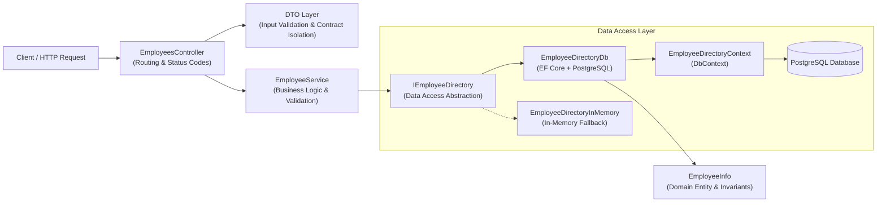

# Employee Directory API

[](https://dotnet.microsoft.com/)
[](https://learn.microsoft.com/aspnet/core)
[](https://learn.microsoft.com/dotnet/csharp/)
[](https://learn.microsoft.com/ef/core/)
[](https://www.postgresql.org/)
[](https://learn.microsoft.com/aspnet/core/fundamentals/openapi)
[](LICENSE)

A asynchronous RESTful Web API for managing employee records, built with **ASP.NET Core**, **C# / .NET 10**, **Entity Framework Core**, and **PostgreSQL**. Designed with clean 3-tier architecture, swappable data-access implementations, strict DTO contract isolation, defensive validation, and end-to-end asynchronous cancellation support.

---

## 📌 Features

- **Full Employee Lifecycle (CRUD)**: Create, retrieve, update, delete, and search employee records over standard HTTP verbs.
- **Relational PostgreSQL Persistence**: Backed by PostgreSQL via **Entity Framework Core** and **Npgsql**, featuring automated code-first migrations (`InitialCreate`).
- **Optimized Database Queries**:
  - Leverages PostgreSQL's native `EF.Functions.ILike` for accelerated, case-insensitive substring search across names and departments.
  - Non-tracking queries (`.AsNoTracking()`) for read-heavy operations to reduce memory allocation.
  - Efficient disconnected entity updates via `DbContext.Entry().CurrentValues.SetValues()`.
- **Swappable Repository Architecture**: Complete abstraction behind `IEmployeeDirectory`, allowing seamless switching between persistent PostgreSQL (`EmployeeDirectoryDb`) and fast in-memory testing (`EmployeeDirectoryInMemory`) with zero modifications to business or controller layers.
- **Proper DI Scoping**: DbContext, repositories, and business services registered with `Scoped` lifetime to ensure clean per-request connection management and transaction isolation.
- **Secure Configuration**: Connection strings managed safely outside source control via **.NET User Secrets** (`UserSecretsId`) and environment variables (`DB_CONN_STRING`).
- **Clean 3-Tier Layered Architecture**: Clear separation of concerns between Controllers, Services, Repositories, and Domain Models.
- **DTO Contract Isolation**: Domain entities are never exposed to public consumers; sensitive attributes (such as compensation) remain strictly encapsulated.
- **Defensive Validation**: Strict `DataAnnotations` (`[Required]`, `[Length]`, `[Range]`) paired with nullable value types (`decimal?`, `DateOnly?`) to catch missing JSON keys before they silently take zero-value defaults.
- **Domain Guard Clauses**: Domain entities encapsulate their own validation logic (e.g., rejecting negative salaries).
- **Asynchronous & Non-Blocking**: Full `async`/`await` pipeline with `CancellationToken` propagation across all layers for responsive server operations.
- **Predictable HTTP Status Codes**: Accurate REST semantics (`201 Created`, `200 OK`, `204 No Content`, `400 Bad Request`, `404 Not Found`, `409 Conflict`) with ASP.NET Core `ProblemDetails`.
- **Integrated API Testing & Docs**: Built-in OpenAPI specification and a ready-to-run `.http` test file for Visual Studio, VS Code, and JetBrains Rider.

---

## 🏗️ Architecture & Design

The application follows a decoupled, layered architecture:



### Layer Responsibilities

1. **Controller Layer (`Controllers/`)**:
   Handles incoming HTTP requests, enforces routing, validates query/path parameters, and returns standard HTTP responses (`CreatedAtAction`, `Ok`, `NotFound`, `Conflict`, etc.).
2. **Service Layer (`Services/`)**:
   Orchestrates business workflows, maps incoming command objects to domain models, and throws strongly-typed domain exceptions upon rule violations.
3. **Repository Layer (`Repositories/` & `Data/`)**:
   - `IEmployeeDirectory`: Contract decoupling the domain from storage mechanics.
   - `EmployeeDirectoryDb`: Production implementation using EF Core and PostgreSQL.
   - `EmployeeDirectoryInMemory`: In-memory implementation useful for offline testing or prototyping.
   - `EmployeeDirectoryContext`: Entity Framework Core database context configured with `DbSet<EmployeeInfo>`.
4. **Data Transfer Objects (`Dtos/`)**:
   - `AddEmployeeRequest` & `EditEmployeeRequest`: Validated input payloads.
   - `AddEmployeeCommand`: Immutable internal command record passed to the service layer.
   - `EmployeeResponse`: Public-facing presentation model, omitting private domain data.
5. **Domain Model (`Models/`)**:
   Encapsulated `EmployeeInfo` class with internal property validation guards.

---

## 🛠️ Tech Stack

- **Framework**: ASP.NET Core Web API (.NET 10.0)
- **Language**: C# 13 (Primary constructors, records, nullable reference types, file-scoped namespaces)
- **Database & ORM**:
  - PostgreSQL
  - Entity Framework Core 10.0 (`Npgsql.EntityFrameworkCore.PostgreSQL`)
  - EF Core Design Tools (`Microsoft.EntityFrameworkCore.Design`)
- **Dependency Injection**: ASP.NET Core Native IoC (Scoped services & DbContext)
- **Configuration & Secrets**: .NET User Secrets, Environment Variables
- **API Documentation**: Microsoft.AspNetCore.OpenApi
- **Testing Tools**: `.http` REST Client file (`EmployeeDirWeb.http`), `curl`

---

## 📡 API Reference

Base URL: `http://localhost:5264` (HTTP) / `https://localhost:7039` (HTTPS)

| Method | Endpoint | Description | Response Status |
|---|---|---|---|
| `POST` | `/api/employees` | Add a new employee | `201 Created`, `400 Bad Request`, `409 Conflict` |
| `GET` | `/api/employees/{id}` | Get employee by ID | `200 OK`, `400 Bad Request`, `404 Not Found` |
| `GET` | `/api/employees` | Search employees by name or department | `200 OK` |
| `PUT` | `/api/employees/{id}` | Update an existing employee | `200 OK`, `400 Bad Request`, `404 Not Found` |
| `DELETE` | `/api/employees/{id}` | Remove an employee | `204 No Content`, `400 Bad Request` |

### Endpoint Details & Examples

#### 1. Add Employee
- **Route**: `POST /api/employees`
- **Headers**: `Content-Type: application/json`

**Request Body:**
```json
{
  "id": "EMP-101",
  "name": "Alex Mercer",
  "department": "Engineering",
  "salary": 82000,
  "hiredDate": "2024-02-01"
}
```

**Response (`201 Created`):**
```json
{
  "id": "EMP-101",
  "name": "Alex Mercer",
  "department": "Engineering"
}
```
*Includes `Location` response header: `/api/employees/EMP-101`.*

---

#### 2. Get Employee by ID
- **Route**: `GET /api/employees/{id}`

**Response (`200 OK`):**
```json
{
  "id": "EMP-101",
  "name": "Alex Mercer",
  "department": "Engineering"
}
```

**Response (`404 Not Found`):**
```text
Employee with id EMP-999 doesn't exist.
```

---

#### 3. Search Employees
- **Route**: `GET /api/employees?name={name}&department={department}`
- Supports optional query parameters. Filtered via PostgreSQL `EF.Functions.ILike` (case-insensitive substring match).

**Example Request:**
```http
GET /api/employees?name=alex&department=eng
```

**Response (`200 OK`):**
```json
[
  {
    "id": "EMP-101",
    "name": "Alex Mercer",
    "department": "Engineering"
  }
]
```

---

#### 4. Update Employee
- **Route**: `PUT /api/employees/{id}`
- **Headers**: `Content-Type: application/json`

**Request Body:**
```json
{
  "name": "Alex Mercer",
  "department": "Platform Core",
  "salary": 92000,
  "hiredDate": "2024-02-01"
}
```

**Response (`200 OK`):**
```json
{
  "id": "EMP-101",
  "name": "Alex Mercer",
  "department": "Platform Core"
}
```

---

#### 5. Delete Employee
- **Route**: `DELETE /api/employees/{id}`

**Response (`204 No Content`)**

---

## 📁 Project Structure

```text
EmployeeDirWeb/
├── Controllers/
│   └── EmployeesController.cs         # API routes, request handling & status codes
├── Services/
│   ├── IEmployeeService.cs            # Business logic contract
│   └── EmployeeService.cs             # Service implementation & orchestration
├── Repositories/
│   ├── IEmployeeDirectory.cs          # Repository interface (data access abstraction)
│   ├── EmployeeDirectoryDb.cs         # PostgreSQL database implementation via EF Core
│   └── EmployeeDirectoryInMemory.cs   # In-memory storage implementation (fallback/tests)
├── Data/
│   └── EmployeeDirectoryContext.cs    # EF Core DbContext definition
├── Migrations/
│   ├── 20261101160510_InitialCreate.cs# Database schema migration
│   └── EmployeeDirectoryContextModelSnapshot.cs # EF Core model snapshot
├── Models/
│   └── EmployeeInfo.cs                # Domain model with encapsulated rules
├── Dtos/
│   ├── AddEmployeeCommand.cs          # Immutable command record for service calls
│   └── Api/
│       ├── AddEmployeeRequest.cs      # Request payload with DataAnnotations
│       ├── EditEmployeeRequest.cs     # Update payload with DataAnnotations
│       └── EmployeeResponse.cs        # Public client response DTO
├── Exceptions/
│   ├── EmployeeNotFoundException.cs   # Custom domain not found exception
│   └── EmployeeAlreadyExistsException.cs # Custom domain duplicate ID exception
├── Properties/
│   └── launchSettings.json            # Local dev ports and launch profiles
├── EmployeeDirWeb.http                # Interactive REST client test queries
├── EmployeeDirWeb.csproj              # Project configuration and package references
└── Program.cs                         # App entry, DI wiring, and middleware pipeline
```

---

## 🚀 Getting Started

### Prerequisites
- [.NET 10 SDK](https://dotnet.microsoft.com/download) (or .NET 9+ equivalent)
- [PostgreSQL](https://www.postgresql.org/download/) running locally or via Docker
- `dotnet-ef` CLI tool (optional, for running migrations):
  ```bash
  dotnet tool install --global dotnet-ef
  ```

### 1. Database Configuration

The application reads the connection string from the `DB_CONN_STRING` configuration key.

You can set this using **.NET User Secrets** (recommended for local development):
```bash
dotnet user-secrets set "DB_CONN_STRING" "Host=localhost;Port=5432;Database=employeedir;Username=postgres;Password=yourpassword"
```

Or pass it as an environment variable:
```bash
export DB_CONN_STRING="Host=localhost;Port=5432;Database=employeedir;Username=postgres;Password=yourpassword"
```

### 2. Apply Migrations

Run EF Core migrations to create the database schema:
```bash
dotnet ef database update
```

### 3. Build & Run

```bash
# Build the project
dotnet build

# Start the application
dotnet run
```

The API will be available at:
- **HTTP**: `http://localhost:5264`
- **HTTPS**: `https://localhost:7039`

### 4. Explore OpenAPI Specification

In development mode, open:
`http://localhost:5264/openapi/v1.json`

> **Tip: Switching to In-Memory Storage**
> If you wish to test without a running PostgreSQL instance, toggle the DI registration in [`Program.cs`](Program.cs):
> ```csharp
> // builder.Services.AddScoped<IEmployeeDirectory, EmployeeDirectoryDb>();
> builder.Services.AddSingleton<IEmployeeDirectory, EmployeeDirectoryInMemory>();
> ```

---

## 🧪 Testing

### Via `.http` File
You can test all endpoints immediately using the included [`EmployeeDirWeb.http`](EmployeeDirWeb.http) file in:
- **VS Code** (using the *REST Client* extension)
- **Visual Studio 2022+**
- **JetBrains Rider**

### Via `curl`
```bash
# 1. Create an employee
curl -i -X POST http://localhost:5264/api/employees \
  -H "Content-Type: application/json" \
  -d '{"id":"EMP-1","name":"Kapil","department":"Engineering","salary":75000,"hiredDate":"2023-06-01"}'

# 2. Get employee by ID
curl -i http://localhost:5264/api/employees/EMP-1

# 3. Search employees (case-insensitive via PostgreSQL ILIKE)
curl -i "http://localhost:5264/api/employees?name=kap&department=it"

# 4. Update employee
curl -i -X PUT http://localhost:5264/api/employees/EMP-1 \
  -H "Content-Type: application/json" \
  -d '{"name":"Kapil Dev","department":"IT","salary":80000,"hiredDate":"2023-06-01"}'

# 5. Delete employee
curl -i -X DELETE http://localhost:5264/api/employees/EMP-1
```

---

## 📄 License

This project is licensed under the [MIT License](LICENSE).
